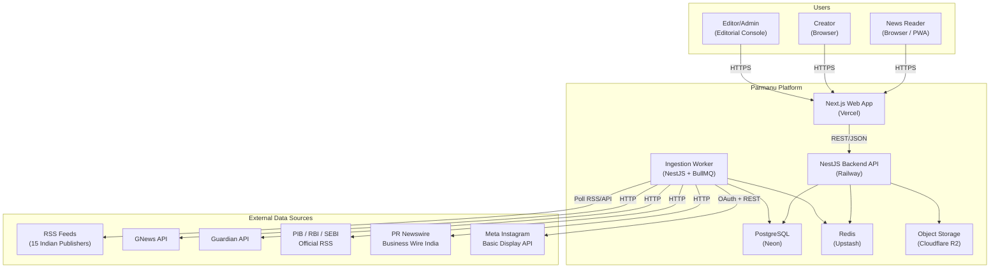
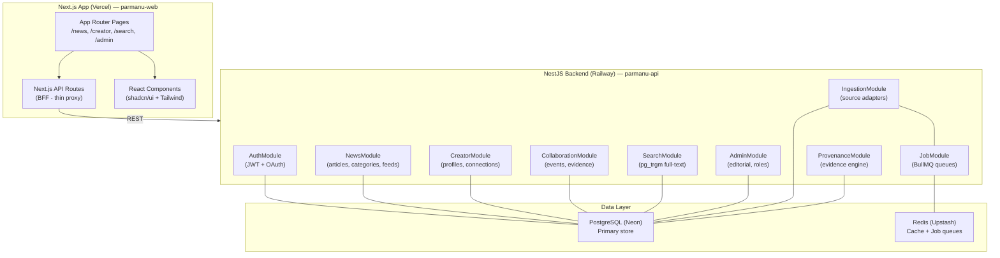
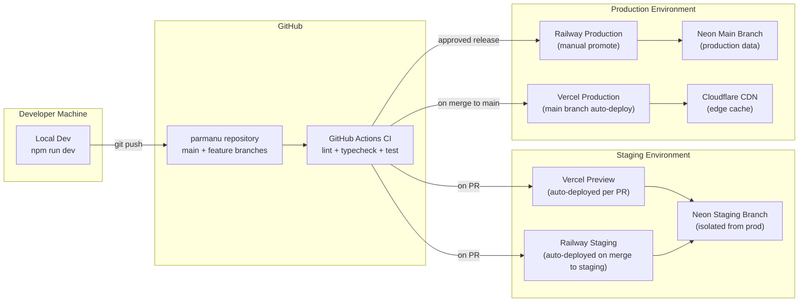

# SYSTEM ARCHITECTURE
**Stage 4 — Technical Architecture**
*Version 1.0 · 2026-10-14*

---

## 1. Architecture Philosophy

- **API-first, modular monolith** — clear module boundaries within a single deployable backend. Avoid premature microservices until scale demands it.
- **TypeScript everywhere** — strict mode, shared types across frontend and backend via a `packages/` workspace.
- **Provenance-first data model** — every record knows its source. Evidence cannot be lost.
- **Defense in depth** — trust boundaries enforced at every layer, not just at the edge.

---

## 2. System Context Diagram



---

## 3. Container / Component Diagram



---

## 4. Module Dependency Map

```
parmanu/
├── apps/
│   ├── web/                    # Next.js 14 (App Router)
│   │   ├── app/               # Routes and layouts
│   │   ├── components/        # Shared UI components
│   │   └── lib/               # API client, auth helpers
│   └── api/                    # NestJS backend
│       ├── src/
│       │   ├── auth/          # JWT, OAuth, session
│       │   ├── news/          # Articles, feeds, categories
│       │   ├── creator/       # Creator profiles, Instagram OAuth
│       │   ├── collaboration/ # Events, evidence
│       │   ├── ingestion/     # Provider adapters, scheduling
│       │   ├── provenance/    # Evidence engine, state machine
│       │   ├── search/        # Full-text search
│       │   ├── admin/         # Editorial dashboard API
│       │   ├── jobs/          # BullMQ queue definitions
│       │   └── common/        # Guards, decorators, filters
│       └── prisma/            # Schema, migrations, seed
├── packages/
│   ├── types/                  # Shared TypeScript types
│   ├── config/                 # Shared ESLint, TSConfig
│   └── utils/                  # Shared utility functions
├── docs/
│   └── phase-1/               # Blueprint documents
└── .github/
    └── workflows/             # CI/CD pipelines
```

---

## 5. Deployment Topology



---

## 6. Trust Boundaries and Threat Model Summary

*(Full threat model in THREAT_MODEL.md)*

| Boundary | Direction | Controls |
|---|---|---|
| Internet → Next.js | Inbound | Cloudflare WAF, HTTPS, CSP headers, rate limiting |
| Browser → Next.js API Routes | Inbound | CSRF token, auth cookie with HttpOnly + Secure + SameSite=Strict |
| Next.js → NestJS API | Internal | API key or mTLS; NestJS not publicly exposed |
| NestJS → Neon DB | Outbound | SSL required; connection string in env secret; least-privilege DB user |
| NestJS → External APIs | Outbound | Secrets in env; never logged; egress firewall if possible |
| Worker → Instagram API | Outbound | Creator tokens encrypted at rest; refreshed server-side only |
| Admin users | Inbound | Separate role guard; MFA recommended; audit log every action |

---

## 7. Synchronous vs. Asynchronous Workflow Decisions

| Operation | Sync/Async | Rationale |
|---|---|---|
| User-facing news feed | Sync (cached) | Low latency required; Redis cache in front |
| Article search | Sync | pg_trgm full-text search; acceptable latency |
| RSS ingestion | Async (BullMQ) | Background job; failure doesn't block users |
| API provider polling | Async (BullMQ scheduled) | Rate-limited; queue handles throttle |
| Provenance classification | Async | CPU-bound; runs after ingestion |
| Editorial notifications | Async | Email/notification queue |
| Instagram token refresh | Async (cron) | Must complete before 60-day expiry |
| User bookmark / follow | Sync | User expects immediate feedback |

---

## 8. Failure and Recovery Paths

| Scenario | Impact | Recovery |
|---|---|---|
| RSS feed 404 | Missing articles from one outlet | Alert; retry in 30 min; mark source as unhealthy after 5 failures |
| External API rate limit | Ingestion paused for that source | Exponential backoff; resume when rate window resets |
| Neon DB connection failure | API returns 503 | Connection pool retry with 3 attempts; circuit breaker after |
| Redis unavailable | Job queue stops; cache miss | Degrade gracefully; continue serving cached content; alert |
| Vercel deployment failure | Web app unavailable | Automatic rollback to last successful deployment |
| Railway deployment failure | API unavailable | Manual rollback via Railway dashboard |
| Instagram token expired | Creator data stale | Notify creator via email to re-authenticate |
| Bad data ingested | Incorrect article shown | Editorial review queue catches before publishing; rollback with audit entry |

---

## 9. Technology Stack — Final Decision

| Layer | Technology | Version | Reason |
|---|---|---|---|
| Frontend framework | Next.js | 14 (App Router) | Industry standard for React SSR; Vercel native |
| UI components | shadcn/ui + Tailwind CSS | Latest | Accessible, composable, zero runtime overhead |
| Backend framework | NestJS | 10+ | Structured, DI-first, TypeScript-native, modular |
| ORM | Prisma | 5+ | Type-safe, Neon-compatible, excellent migration tooling |
| Database | PostgreSQL (Neon) | 15+ | Relational, full-text search via pg_trgm, ACID |
| Job queue | BullMQ + Upstash Redis | Latest | Durable, Redis-backed, TypeScript-native |
| Auth library | NextAuth.js (web) + Passport (API) | Latest | Industry standard; supports OAuth + credentials |
| Validation | Zod | 3+ | Runtime + compile-time; shared with frontend |
| Testing | Vitest (unit) + Playwright (e2e) | Latest | Fast, modern, Vite-native |
| Linting | ESLint + Prettier | Latest | Enforced in CI |
| Type-checking | TypeScript strict | 5+ | Required; no `any` escapes |
| CI/CD | GitHub Actions | — | Free for public; tight GitHub integration |
| Hosting (web) | Vercel | — | Zero-config Next.js deployment |
| Hosting (API) | Railway | — | Simple Docker-based Node deployment |
| Monitoring | Sentry (errors) + Vercel Analytics | — | Free tiers sufficient for Phase 1 |
| Secret management | Environment variables + GitHub Secrets | — | Never in source code |

---

## 10. Mobile Application Decision

**Decision: Deferred to Phase 3.**

React Native will be evaluated after the web MVP is validated. The responsive Next.js web app (PWA-capable) serves mobile browsers for Phase 1. Android and iOS native apps will be built using React Native with Expo, sharing business logic from `packages/` with the web app.
