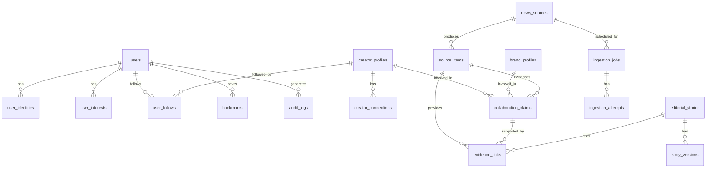

# DATA MODEL AND CONTRACTS
**Stage 5 — Database Schema and Canonical Data Contracts**
*Version 1.0 · 2026-10-14*

---

## Design Principles

1. **Provenance is not optional** — every content record references its source.
2. **Raw ≠ Normalized ≠ Approved** — pipeline stages are logically distinct in the schema.
3. **Audit everything** — mutations on editorial records are logged, not overwritten.
4. **Minimal collection** — no column exists without a documented purpose.
5. **Soft delete where legally required** — `deleted_at` timestamp; GDPR/DPDP right-to-erasure honored by anonymization, not hard delete, for records with foreign keys.

---

## Entity Overview



---

## Canonical Schemas (Prisma SDL)

```prisma
// ─── USERS AND AUTH ───────────────────────────────────────────────

model User {
  id              String   @id @default(cuid())
  email           String   @unique
  emailVerified   DateTime?
  name            String?
  avatarUrl       String?
  role            UserRole @default(READER)
  createdAt       DateTime @default(now())
  updatedAt       DateTime @updatedAt
  deletedAt       DateTime? // Soft delete; anonymize PII on deletion

  identities      UserIdentity[]
  interests       UserInterest[]
  follows         UserFollow[]
  bookmarks       Bookmark[]
  auditLogs       AuditLog[]       @relation("ActorAuditLogs")

  @@index([email])
  @@index([role])
}

enum UserRole {
  READER
  EDITOR
  ADMIN
}

model UserIdentity {
  id           String   @id @default(cuid())
  userId       String
  provider     String   // "google" | "instagram" | "credentials"
  providerAccountId String
  accessToken  String?  // Encrypted at rest (AES-256-GCM) — Instagram tokens only
  refreshToken String?  // Encrypted at rest
  tokenExpiry  DateTime?
  scope        String?
  createdAt    DateTime @default(now())
  updatedAt    DateTime @updatedAt

  user         User     @relation(fields: [userId], references: [id], onDelete: Cascade)

  @@unique([provider, providerAccountId])
  @@index([userId])
}

// ─── CREATOR INTELLIGENCE ─────────────────────────────────────────

model CreatorProfile {
  id              String   @id @default(cuid())
  instagramHandle String?  @unique
  displayName     String
  bio             String?
  avatarUrl       String?  // URL to Cloudflare R2 cached image (with creator consent)
  category        String[] // "fashion" | "tech" | "food" | etc.
  verifiedAt      DateTime? // When creator authenticated with Parmanu
  isVerified      Boolean  @default(false)
  followerRange   String?  // e.g., "100K-500K" — never exact, for privacy
  officialLinks   Json?    // {"website": "...", "youtube": "..."}
  createdAt       DateTime @default(now())
  updatedAt       DateTime @updatedAt
  deletedAt       DateTime?

  connections     CreatorConnection[]
  claims          CollaborationClaim[]
  follows         UserFollow[]

  @@index([instagramHandle])
  @@index([isVerified])
}

model CreatorConnection {
  id              String   @id @default(cuid())
  creatorProfileId String
  instagramUserId  String   @unique // Meta user ID — not the handle
  accessToken      String   // Encrypted at rest
  tokenType        String   // "basic_display" | "graph_api"
  tokenExpiry      DateTime
  scopes           String[] // Granted OAuth scopes
  connectedAt      DateTime @default(now())
  revokedAt        DateTime?
  deletionScheduledAt DateTime? // Set to connectedAt + 30 days when revoked

  creatorProfile   CreatorProfile @relation(fields: [creatorProfileId], references: [id])

  @@index([creatorProfileId])
  @@index([tokenExpiry])
}

// ─── BRANDS AND ORGANIZATIONS ─────────────────────────────────────

model BrandProfile {
  id            String   @id @default(cuid())
  name          String
  slug          String   @unique
  sector        String?  // "FMCG" | "fashion" | "tech" | etc.
  description   String?
  logoUrl       String?
  officialLinks Json?
  createdAt     DateTime @default(now())
  updatedAt     DateTime @updatedAt

  claims        CollaborationClaim[]

  @@index([slug])
}

// ─── NEWS SOURCES AND INGESTION ───────────────────────────────────

model NewsSource {
  id            String       @id @default(cuid())
  name          String
  slug          String       @unique
  type          SourceType
  feedUrl       String?      // RSS/Atom URL
  apiProvider   String?      // "gnews" | "guardian" | "newsdata"
  apiConfig     Json?        // Provider-specific config (no secrets here)
  category      String[]     // Categories this source covers
  language      String       @default("en")
  country       String       @default("IN")
  isActive      Boolean      @default(true)
  pollingIntervalMinutes Int @default(15)
  lastPolledAt  DateTime?
  lastSuccessAt DateTime?
  failureCount  Int          @default(0)
  attributionName String     // Required by most ToS
  attributionUrl  String
  createdAt     DateTime     @default(now())
  updatedAt     DateTime     @updatedAt

  sourceItems   SourceItem[]
  ingestionJobs IngestionJob[]

  @@index([isActive, pollingIntervalMinutes])
  @@index([type])
}

enum SourceType {
  RSS
  ATOM
  API_GNEWS
  API_GUARDIAN
  API_NEWSDATA
  MANUAL_PR
  GOVERNMENT_FEED
  INSTAGRAM_API
}

model SourceItem {
  id              String           @id @default(cuid())
  sourceId        String
  externalId      String?          // Provider's own ID
  canonicalUrl    String           // Original source URL — required
  headline        String
  excerpt         String?          // Max 300 chars; no full text
  author          String?
  publishedAt     DateTime
  firstSeenAt     DateTime         @default(now())
  lastCheckedAt   DateTime         @default(now())
  contentType     ContentType
  category        String[]
  language        String           @default("en")
  imageUrl        String?          // Original image URL (not cached; copyright unclear)
  processingState ProcessingState  @default(PENDING)
  provenanceState ProvenanceState  @default(SINGLE_SOURCE)
  rightsStatus    RightsStatus     @default(UNKNOWN)
  retentionDays   Int              @default(90)
  retainUntil     DateTime         // firstSeenAt + retentionDays
  dedupeHash      String           // SHA-256 of normalized headline + sourceId
  createdAt       DateTime         @default(now())
  updatedAt       DateTime         @updatedAt

  source          NewsSource       @relation(fields: [sourceId], references: [id])
  evidenceLinks   EvidenceLink[]
  collaborationClaims CollaborationClaim[]

  @@unique([sourceId, canonicalUrl])
  @@unique([dedupeHash])
  @@index([publishedAt(sort: Desc)])
  @@index([processingState])
  @@index([category])
  @@index([provenanceState])
}

enum ContentType {
  NEWS_ARTICLE
  PRESS_RELEASE
  GOVERNMENT_ANNOUNCEMENT
  SPORTS_UPDATE
  CREATOR_ANNOUNCEMENT
  INSTAGRAM_POST
}

enum ProcessingState {
  PENDING       // Just ingested; awaiting processing
  PROCESSING    // Currently being processed
  NORMALIZED    // Processed; awaiting editorial review
  APPROVED      // Editor approved; visible to users
  REJECTED      // Editor rejected; not shown to users
  EXPIRED       // Past retention window; archived
}

enum ProvenanceState {
  OFFICIAL_CONFIRMED  // Direct statement from the entity
  CORROBORATED        // ≥2 independent credible sources
  SINGLE_SOURCE       // One credible outlet
  UNVERIFIED          // Claimed, not confirmed
  DISPUTED            // Actively contradicted
  INFERRED            // Derived from multiple signals
}

enum RightsStatus {
  UNKNOWN
  METADATA_ONLY       // Attribution required; no full text
  LICENSED_EXCERPT    // Licensed for excerpt display
  LICENSED_FULL       // Full content license (future)
  PUBLIC_DOMAIN       // Government/official — public domain
}

// ─── COLLABORATION INTELLIGENCE ───────────────────────────────────

model CollaborationClaim {
  id               String           @id @default(cuid())
  creatorProfileId String
  brandProfileId   String
  campaignName     String?
  claimType        ClaimType
  provenanceState  ProvenanceState  @default(UNVERIFIED)
  claimDate        DateTime?        // When the collaboration was announced
  observedAt       DateTime         @default(now())
  resolvedAt       DateTime?
  reviewedBy       String?          // Editor user ID who reviewed
  reviewNote       String?
  isActive         Boolean          @default(true)
  createdAt        DateTime         @default(now())
  updatedAt        DateTime         @updatedAt

  creatorProfile   CreatorProfile   @relation(fields: [creatorProfileId], references: [id])
  brandProfile     BrandProfile     @relation(fields: [brandProfileId], references: [id])
  evidenceLinks    EvidenceLink[]
  sourceItems      SourceItem[]

  @@index([creatorProfileId])
  @@index([brandProfileId])
  @@index([provenanceState])
  @@index([claimDate(sort: Desc)])
}

enum ClaimType {
  BRAND_COLLABORATION
  SPONSORED_POST
  AMBASSADOR
  PRODUCT_GIFTING
  EVENT_APPEARANCE
}

// ─── EVIDENCE ENGINE ──────────────────────────────────────────────

model EvidenceLink {
  id                   String           @id @default(cuid())
  collaborationClaimId String?
  editorialStoryId     String?
  sourceItemId         String
  relationshipType     EvidenceRelation
  evidenceStatus       EvidenceStatus   @default(ACTIVE)
  observedAt           DateTime
  reviewerUserId       String?
  reviewedAt           DateTime?
  supersededById       String?          // If this evidence was corrected
  notes                String?
  createdAt            DateTime         @default(now())

  collaborationClaim   CollaborationClaim? @relation(fields: [collaborationClaimId], references: [id])
  editorialStory       EditorialStory?     @relation(fields: [editorialStoryId], references: [id])
  sourceItem           SourceItem          @relation(fields: [sourceItemId], references: [id])

  @@index([collaborationClaimId])
  @@index([sourceItemId])
  @@index([evidenceStatus])
}

enum EvidenceRelation {
  PRIMARY_SOURCE        // The claim originates here
  CORROBORATING         // Independently confirms the claim
  CONTRADICTING         // Disputes the claim
  BACKGROUND            // Context, not direct evidence
  OFFICIAL_STATEMENT    // Direct statement from involved party
}

enum EvidenceStatus {
  ACTIVE
  SUPERSEDED
  RETRACTED
  DISPUTED
}

// ─── EDITORIAL ────────────────────────────────────────────────────

model EditorialStory {
  id            String   @id @default(cuid())
  slug          String   @unique
  headline      String
  summary       String
  category      String[]
  status        StoryStatus @default(DRAFT)
  authorId      String
  publishedAt   DateTime?
  createdAt     DateTime @default(now())
  updatedAt     DateTime @updatedAt

  versions      StoryVersion[]
  evidenceLinks EvidenceLink[]

  @@index([status])
  @@index([publishedAt(sort: Desc)])
}

enum StoryStatus {
  DRAFT
  UNDER_REVIEW
  APPROVED
  PUBLISHED
  ARCHIVED
}

model StoryVersion {
  id               String   @id @default(cuid())
  editorialStoryId String
  versionNumber    Int
  headline         String
  summary          String
  changeNote       String?  // Why this version was created
  createdBy        String   // Editor user ID
  createdAt        DateTime @default(now())

  editorialStory   EditorialStory @relation(fields: [editorialStoryId], references: [id])

  @@unique([editorialStoryId, versionNumber])
}

// ─── USER ENGAGEMENT ──────────────────────────────────────────────

model UserInterest {
  id        String   @id @default(cuid())
  userId    String
  category  String
  weight    Float    @default(1.0) // 0.0–5.0; increased on interaction
  createdAt DateTime @default(now())
  updatedAt DateTime @updatedAt

  user      User     @relation(fields: [userId], references: [id], onDelete: Cascade)

  @@unique([userId, category])
}

model UserFollow {
  id               String   @id @default(cuid())
  userId           String
  creatorProfileId String?
  brandProfileId   String?
  followedAt       DateTime @default(now())

  user             User             @relation(fields: [userId], references: [id], onDelete: Cascade)
  creatorProfile   CreatorProfile?  @relation(fields: [creatorProfileId], references: [id])

  @@unique([userId, creatorProfileId])
  @@unique([userId, brandProfileId])
}

model Bookmark {
  id           String   @id @default(cuid())
  userId       String
  sourceItemId String?
  storyId      String?
  createdAt    DateTime @default(now())

  user         User     @relation(fields: [userId], references: [id], onDelete: Cascade)

  @@unique([userId, sourceItemId])
  @@unique([userId, storyId])
  @@index([userId])
}

// ─── INGESTION INFRASTRUCTURE ─────────────────────────────────────

model IngestionJob {
  id           String       @id @default(cuid())
  sourceId     String
  jobType      JobType
  status       JobStatus    @default(PENDING)
  scheduledAt  DateTime
  startedAt    DateTime?
  completedAt  DateTime?
  itemsFound   Int?
  itemsNew     Int?
  errorSummary String?
  createdAt    DateTime     @default(now())

  source       NewsSource   @relation(fields: [sourceId], references: [id])
  attempts     IngestionAttempt[]

  @@index([sourceId, scheduledAt])
  @@index([status])
}

enum JobType {
  RSS_POLL
  API_POLL
  INSTAGRAM_SYNC
  TOKEN_REFRESH
}

enum JobStatus {
  PENDING
  RUNNING
  COMPLETED
  FAILED
  SKIPPED
}

model IngestionAttempt {
  id             String   @id @default(cuid())
  ingestionJobId String
  attemptNumber  Int
  startedAt      DateTime @default(now())
  completedAt    DateTime?
  success        Boolean
  errorCode      String?
  errorMessage   String?  // Never include secrets or tokens in error messages
  httpStatus     Int?
  responseTimeMs Int?

  ingestionJob   IngestionJob @relation(fields: [ingestionJobId], references: [id])

  @@index([ingestionJobId])
}

// ─── AUDIT LOG (IMMUTABLE) ────────────────────────────────────────

model AuditLog {
  id         String   @id @default(cuid())
  actorId    String?  // User ID; null for system actions
  actorRole  String?
  action     String   // e.g., "APPROVE_SOURCE_ITEM", "REJECT_CLAIM", "UPDATE_PROVENANCE"
  entityType String   // e.g., "SourceItem", "CollaborationClaim"
  entityId   String
  before     Json?    // Previous state snapshot (redact sensitive fields)
  after      Json?    // New state snapshot (redact sensitive fields)
  reason     String?  // Required for editorial overrides
  ipAddress  String?
  userAgent  String?
  createdAt  DateTime @default(now())

  actor      User?    @relation("ActorAuditLogs", fields: [actorId], references: [id])

  // No UPDATE or DELETE on audit log — enforced by DB-level policy
  @@index([actorId])
  @@index([entityType, entityId])
  @@index([createdAt(sort: Desc)])
}
```

---

## Canonical Source-Item Contract

| Field | Type | Required | Notes |
|---|---|---|---|
| `id` | CUID | ✅ | Internal identifier |
| `sourceId` | FK → NewsSource | ✅ | Which source produced this |
| `externalId` | String | Optional | Provider's own ID |
| `canonicalUrl` | String | ✅ | Original article URL |
| `headline` | String | ✅ | Original headline |
| `excerpt` | String ≤300 | Optional | Metadata only; no full text |
| `author` | String | Optional | Byline |
| `publishedAt` | DateTime | ✅ | Publisher's stated publication time |
| `firstSeenAt` | DateTime | ✅ | When Parmanu ingested this |
| `lastCheckedAt` | DateTime | ✅ | Last time we confirmed the URL exists |
| `contentType` | Enum | ✅ | NEWS_ARTICLE, PRESS_RELEASE, etc. |
| `processingState` | Enum | ✅ | PENDING → APPROVED pipeline state |
| `provenanceState` | Enum | ✅ | Evidence quality level |
| `rightsStatus` | Enum | ✅ | What we're permitted to do with this |
| `retainUntil` | DateTime | ✅ | Calculated retention expiry |
| `dedupeHash` | String | ✅ | Uniqueness enforcement |

---

## Canonical Evidence Contract

| Field | Type | Required | Notes |
|---|---|---|---|
| `id` | CUID | ✅ | Internal identifier |
| `collaborationClaimId` | FK | Optional | If supporting a collaboration |
| `editorialStoryId` | FK | Optional | If cited in a story |
| `sourceItemId` | FK → SourceItem | ✅ | The evidence source |
| `relationshipType` | Enum | ✅ | PRIMARY_SOURCE, CORROBORATING, etc. |
| `evidenceStatus` | Enum | ✅ | ACTIVE, SUPERSEDED, RETRACTED |
| `observedAt` | DateTime | ✅ | When this evidence was observed |
| `reviewerUserId` | FK → User | Optional | Editor who reviewed |
| `supersededById` | FK → EvidenceLink | Optional | Correction chain |

---

## Index Strategy

| Table | Index | Reason |
|---|---|---|
| `source_items` | `(published_at DESC)` | Feed ordering |
| `source_items` | `(processing_state)` | Editorial queue |
| `source_items` | `(category)` | Category feeds |
| `source_items` | `(dedupe_hash)` | Deduplication check |
| `collaboration_claims` | `(creator_profile_id)` | Creator profile page |
| `collaboration_claims` | `(brand_profile_id)` | Brand profile page |
| `audit_logs` | `(entity_type, entity_id)` | Entity history |
| `users` | `(email)` | Auth lookup |

---

## Retention and Deletion Policy

| Data Type | Retention | Deletion Trigger |
|---|---|---|
| Source item metadata | 90 days default | `retainUntil` field; scheduled cleanup job |
| User account | Until deletion request | GDPR/DPDP erasure request; anonymize PII |
| Creator OAuth tokens | Until revoked | `deletionScheduledAt` + 30-day job |
| Audit logs | 2 years | Regulatory compliance; no hard delete |
| Ingestion attempt logs | 30 days | Operational; cleanup job |
| Editorial stories | Indefinite | Manually archived by editors |
