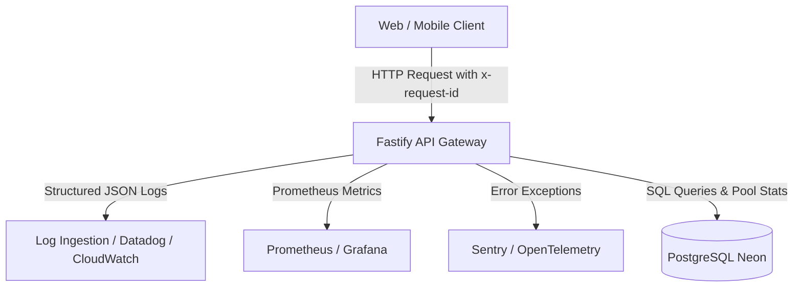

# Parmanu Observability, Telemetry & Incident Runbooks

**Document Version:** 1.0.0  
**Phase:** 1 (Foundation Hardening & Security Audit)  
**Status:** Approved & Implemented  
**Date:** 2026-10-14  

---

## 1. Observability Architecture

Parmanu's observability strategy focuses on the four golden signals: **Latency**, **Traffic**, **Errors**, and **Saturation**.



---

## 2. Structured Logging Specification

All system output is written to `stdout`/`stderr` as single-line structured JSON. Plain text and multi-line unformatted stack traces are forbidden in production.

### 2.1 Log Schema Standard
```json
{
  "timestamp": "2026-10-14T09:15:32.104Z",
  "level": "info",
  "service": "parmanu-api",
  "requestId": "req-983b4d55-fb0f-4aa0-a8e4-ab65c678b7e5",
  "userId": "usr_998124",
  "clientIp": "203.0.113.195",
  "method": "GET",
  "path": "/api/v1/feed",
  "statusCode": 200,
  "durationMs": 42.6,
  "message": "Feed retrieved successfully",
  "tags": {
    "category": "national",
    "cached": false
  }
}
```

### 2.2 Redaction & Masking Rules
The logger automatically redacts sensitive keys using standard field sanitizers:
- Headers: `Authorization`, `Cookie`, `Set-Cookie`, `X-Api-Key`.
- Body Fields: `password`, `token`, `accessToken`, `refreshToken`, `clientSecret`, `secretKey`, `encryptionKey`.
- Query Parameters: `auth`, `token`, `key`.

---

## 3. Health & Readiness Endpoints

The API exposes standard probe endpoints for orchestration engines and uptime monitors:

| Endpoint | Path | Purpose | Success Condition | Downstream Checks |
| :--- | :--- | :--- | :--- | :--- |
| **Liveness Probe** | `GET /health` | Validates process is running and responding to event loop | HTTP 200 `{"status":"ok"}` | None |
| **Readiness Probe** | `GET /ready` | Validates application can serve live user traffic | HTTP 200 `{"status":"ready"}` | Database `SELECT 1` query responds in < 1000ms |

---

## 4. Operational Runbooks

### Runbook 1: Database Connection Pool Exhaustion
- **Symptom:** API logs indicate `Connection pool timeout` or `FATAL: remaining connection slots are reserved for non-replication superuser connections`. High HTTP 500 error rates.
- **Root Cause:** Leaked database clients, long-running batch ingestion queries blocking web requests, or abrupt traffic spike.
- **Immediate Mitigation:**
  1. Verify connection string uses the Neon connection pooler port (default pooler endpoint: `-pooler.c-7.us-east-2.aws.neon.tech`).
  2. Increase pooler limits in Neon console or adjust pool size in `DATABASE_URL` (`?connection_limit=20&pool_timeout=10`).
  3. Kill hanging queries via PostgreSQL console:
     ```sql
     SELECT pg_terminate_backend(pid) 
     FROM pg_stat_activity 
     WHERE state = 'idle in transaction' 
       AND state_change < current_timestamp - INTERVAL '2 minutes';
     ```
  4. Temporarily throttle or suspend ingestion cron workers.

### Runbook 2: Upstream Source Outage or Feed Schema Drift
- **Symptom:** Ingestion logs show `ConnectorError: HTTP 403 Forbidden` or `ZodValidationError` for feed parsing (e.g. RSS feed XML format changed).
- **Root Cause:** Source provider blocked Parmanu user-agent, changed feed endpoint, or emitted invalid XML.
- **Immediate Mitigation:**
  1. Check source status page or test feed endpoint manually using `curl -I -A "ParmanuNewsEngine/1.0" <feed_url>`.
  2. If blocked by Cloudflare/Akamai, inspect User-Agent header in `apps/api/src/connectors/rss.connector.ts`.
  3. Disable faulty connector in `source_registry` table:
     ```sql
     UPDATE source_registry SET status = 'degraded' WHERE name = 'the-hindu';
     ```
  4. Existing stories remain in the database; users continue receiving cached and historical feed items.

### Runbook 3: Elevated API Latency (P95 > 500ms)
- **Symptom:** APM / CloudWatch alerts fire for P95 latency > 500ms on `/api/v1/feed`.
- **Root Cause:** Missing database indices on new query filters, cold start latency on serverless database compute, or unindexed pagination (`OFFSET` without indexed cursor).
- **Immediate Mitigation:**
  1. Inspect `EXPLAIN ANALYZE` for `/api/v1/feed` queries:
     ```sql
     EXPLAIN ANALYZE 
     SELECT * FROM stories 
     WHERE status = 'published' 
     ORDER BY published_at DESC 
     LIMIT 20;
     ```
  2. Verify index on `(status, published_at DESC)` exists.
  3. Ensure cursor-based pagination is utilized instead of high-offset queries.
