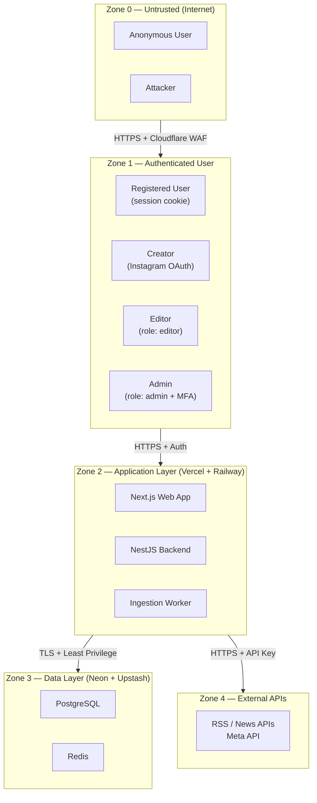

# THREAT MODEL
**Stage 4 — Security Architecture and Threat Analysis**
*Version 1.0 · 2026-10-14 · Based on OWASP ASVS 4.0 and OWASP API Security Top 10*

---

## 1. System Assets

| Asset | Sensitivity | Value |
|---|---|---|
| User PII (email, name, preferences) | High | Account identity |
| Creator OAuth tokens (Instagram) | Critical | Access to creator's Instagram account |
| Database connection string | Critical | Full database access |
| API keys (GNews, Guardian, Meta) | High | Quota consumption, billing |
| Session tokens / JWTs | High | User impersonation |
| Editorial decisions and audit logs | Medium | Editorial integrity |
| Ingested news metadata | Low | Public information |
| Admin credentials | Critical | Platform control |

---

## 2. Trust Zones

---

## 3. STRIDE Threat Analysis

### T-001: Authentication Bypass (SPOOFING)

**Asset threatened:** User sessions, admin access
**Attack vector:** JWT forgery, session fixation, credential stuffing
**Likelihood:** Medium
**Impact:** High

**Controls:**
- JWT signed with RS256 (asymmetric); secret never in source code
- Session cookie: `HttpOnly; Secure; SameSite=Strict; __Host-` prefix
- Credentials endpoint: Rate limited to 10 attempts/minute per IP
- Argon2id for password hashing (OWASP recommended)
- Admin accounts: MFA enforced; separate admin subdomain or path
- Failed login events logged to audit log

**Acceptance criteria:** Automated brute-force tool (Hydra) blocked after 10 attempts without valid credential. JWT with tampered signature rejected with 401.

---

### T-002: SQL Injection (TAMPERING)

**Asset threatened:** Database
**Attack vector:** Unsanitized query parameters passed to database
**Likelihood:** Low (Prisma parameterizes by default)
**Impact:** Critical

**Controls:**
- All database queries through Prisma ORM with parameterized queries
- `$queryRaw` with tagged template literals only (never string concatenation)
- Input validation via Zod before any database operation
- Database user has least-privilege grants (SELECT/INSERT/UPDATE/DELETE on specific tables; no DROP/ALTER)

**Acceptance criteria:** OWASP ZAP SQL injection scan returns zero confirmed findings.

---

### T-003: Unauthorized Data Access (ELEVATION OF PRIVILEGE)

**Asset threatened:** Other users' bookmarks, private preferences, creator OAuth tokens
**Attack vector:** IDOR (Insecure Direct Object Reference), broken authorization
**Likelihood:** Medium
**Impact:** High

**Controls:**
- All resource access checks include user ownership: `WHERE id = ? AND user_id = ?`
- NestJS guards enforce role-based access: `@Roles('admin')`, `@Roles('editor')`
- Creator OAuth tokens never exposed via API response; used server-side only
- API responses filtered by user context before serialization

**Acceptance criteria:** Manual penetration test confirms user A cannot access user B's bookmarks or creator tokens by guessing IDs.

---

### T-004: Secret Exposure (INFORMATION DISCLOSURE)

**Asset threatened:** Database credentials, API keys, OAuth tokens
**Attack vector:** Committed secrets in Git, leaked environment variables, verbose error responses
**Likelihood:** Medium
**Impact:** Critical

**Controls:**
- `.env` files in `.gitignore` from first commit
- GitHub secret scanning enabled on repository
- `gitleaks` scans in CI pipeline (pre-push hook)
- Production error responses never include stack traces or internal details
- Logging infrastructure configured to never log values of environment variables
- Separate secrets per environment (staging secrets ≠ production secrets)

**Acceptance criteria:** `gitleaks` scan of entire Git history returns zero findings. Production API returns generic error messages (not stack traces).

---

### T-005: Rate Limit Bypass and Denial of Service (DENIAL OF SERVICE)

**Asset threatened:** Platform availability, external API quota
**Attack vector:** High-volume requests to search or feed endpoints; abuse of ingestion triggers
**Likelihood:** Medium
**Impact:** Medium

**Controls:**
- Global rate limiting: 100 requests/minute per IP via NestJS ThrottlerModule
- Search endpoint: 10 requests/minute per authenticated user
- Authentication endpoints: 10 attempts/minute per IP
- Cloudflare DDoS protection at edge
- BullMQ job queue prevents ingestion thundering herd
- External API calls tracked in Redis; stopped before rate limit exceeded

**Acceptance criteria:** Load test (k6) confirms 429 response after 101 requests within one minute from same IP.

---

### T-006: XSS via News Content (TAMPERING + SPOOFING)

**Asset threatened:** User browser sessions, user trust
**Attack vector:** Malicious content in RSS feed article titles or descriptions rendered as HTML
**Likelihood:** Medium
**Impact:** High

**Controls:**
- All RSS content sanitized server-side using `DOMPurify` (server-side variant) before storage
- React's JSX rendering escapes by default; no `dangerouslySetInnerHTML` without explicit sanitization
- Content Security Policy header: `default-src 'self'; script-src 'self' 'nonce-{random}'`
- External images proxied through Cloudflare; no direct external image src in article cards

**Acceptance criteria:** Injecting `` into a mocked RSS title returns escaped HTML in browser; no alert fires.

---

### T-007: OAuth Token Theft (ELEVATION OF PRIVILEGE)

**Asset threatened:** Creator's Instagram account access
**Attack vector:** Man-in-the-middle, token logged in error messages, database breach
**Likelihood:** Low
**Impact:** Critical

**Controls:**
- OAuth tokens encrypted at rest (AES-256-GCM) before database storage
- Tokens never returned in API responses; used server-side only
- HTTPS enforced; HSTS header set
- Token refresh runs server-side in background job
- Immediate revocation when creator disconnects
- Data deletion job runs within 30 days of revocation

**Acceptance criteria:** Database dump of `creator_connections` table shows encrypted token value, not plaintext. No token value appears in any API response or log.

---

### T-008: Supply Chain Attack (TAMPERING)

**Asset threatened:** Application integrity
**Attack vector:** Compromised npm package
**Likelihood:** Low
**Impact:** High

**Controls:**
- `pnpm` with `lockfile-check` in CI
- GitHub Dependabot enabled for dependency updates
- `npm audit` (or `pnpm audit`) in CI pipeline; fail on critical severity
- No `--legacy-peer-deps` or `--force` in CI installs
- Package integrity verified via lockfile SHA

**Acceptance criteria:** CI fails when a package with a known critical vulnerability is added.

---

### T-009: Admin Panel Exposure (ELEVATION OF PRIVILEGE)

**Asset threatened:** Editorial control, user data
**Attack vector:** Admin endpoints accessible to non-admin users
**Likelihood:** Medium
**Impact:** Critical

**Controls:**
- Admin routes (`/admin/*`) protected by NestJS `@Roles('admin')` guard
- Admin module deployed as a separate route group; not exposed in public Next.js routes
- MFA required for admin accounts (enforced in auth flow)
- Admin actions logged in immutable audit log (INSERT only; no UPDATE/DELETE on audit log table)
- Admin session timeout: 1 hour of inactivity

**Acceptance criteria:** Authenticated editor user receives 403 when accessing admin-only endpoints. Admin audit log is non-modifiable via API.

---

## 4. Data Privacy Threat Analysis

| Risk | Regulation | Control |
|---|---|---|
| Collecting user data without consent | India DPDP Act 2023 | Explicit consent UI; consent stored in DB with timestamp |
| Retaining creator data after revocation | Meta Platform Policy | 30-day deletion job; deletion audit trail |
| Analytics identifying individual users | India DPDP Act, GDPR | No PII in analytics events; use anonymized user IDs |
| User email used for spam | India IT Act | Email used only for transactional purposes; unsubscribe honored |

---

## 5. Security Testing Requirements

| Test Type | Tool | Frequency | Gate |
|---|---|---|---|
| SAST | ESLint security plugin | Every PR | CI required |
| Dependency audit | pnpm audit | Every PR | CI required; fail on critical |
| Secret scanning | gitleaks | Every push | Pre-push hook + CI |
| OWASP ZAP baseline | OWASP ZAP | Every staging deployment | Not blocking Phase 1; required Phase 2 |
| Manual penetration test | External firm | Before production launch | Required |
| Load test | k6 | Before production launch | Required |

---

## 6. Incident Response

| Severity | Example | Response Time | Owner |
|---|---|---|---|
| P0 — Critical | DB credentials exposed, active breach | 15 minutes | CTO + On-call |
| P1 — High | API down, OAuth tokens at risk | 1 hour | Engineering lead |
| P2 — Medium | Rate limit bypass, elevated error rate | 4 hours | On-call engineer |
| P3 — Low | Single source ingestion failure | Next business day | Engineering |

**Rollback procedure:** Every production deployment tagged in Git. Railway supports one-click rollback. Neon supports point-in-time recovery (PITR). Database migrations must be backward-compatible before deployment (expand-contract pattern).
