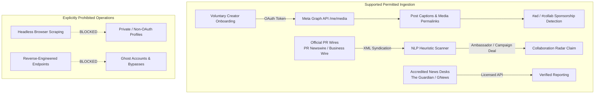

# Creator Data Capability & Licensing Matrix
## Parmanu Platform — Phase 2.1 Compliance & Verification Matrix

---

### 1. Architectural Stance on Creator Data

Parmanu adheres to a strict zero-scraping, zero-circumvention policy. Under Meta's Terms of Service and developer policies, automated crawling, scraping behind authentication walls, or bypassing rate limits is strictly forbidden and poses legal, reliability, and security risks.

All creator-related intelligence in Parmanu is collected through:
1. **Voluntary Creator OAuth Integration**: Creators connect their own Instagram accounts using Meta Graph API / Instagram Basic Display API to index their portfolios.
2. **Public Corporate PR Wires & Press Releases**: Brand ambassador signings, sponsorship deals, and marketing campaigns officially announced on PR Newswire, Business Wire India, etc.
3. **Corroborated Public News Reporting**: Verified reporting from accredited national and international news desks.

---

### 2. Comprehensive Capability Matrix

| Capability | Verification Status | Legal & Technical Classification | Technical Endpoint & Scope | Verification Evidence | Operational Constraints & Next Steps |
|---|---|---|---|---|---|
| **Voluntary Creator Profile Metadata** | **SUPPORTED** | Permitted with Creator Consent | Meta Graph API: `GET /me?fields=id,username,account_type` | Verified via `InstagramApiConnector` unit tests with token authorization. | Only available for creators who grant `user_profile` OAuth permission. Private profiles ineligible. |
| **Voluntary Creator Posts & Media Metadata** | **SUPPORTED** | Permitted with Creator Consent | Meta Graph API: `GET /me/media?fields=id,caption,media_type,media_url,permalink,timestamp` | Ingests post timestamp, permalink, caption, and image URL. Verified in test suite. | Rate limited to 200 calls/hour per user by Meta. Token refresh required every 60 days. |
| **Arbitrary Public Instagram Account Scraping** | **UNAVAILABLE** | **PROHIBITED** by Meta Platform Terms | N/A (Web scraping / headless browser bots) | Prohibited under Meta ToS Section 3.2.1. No scraping infrastructure permitted in Parmanu. | **Do not implement**. Any monitoring of creators who have not linked their account must rely on official press releases. |
| **Brand Collaboration & Sponsorship Detection (PR Wires)** | **SUPPORTED** | Public Commercial Information | PR Newswire India / Business Wire RSS XML endpoints | Verified via `PrWireConnector` collaboration regex heuristics. | Captures official brand-creator endorsements, campaign launches, and agency announcements. |
| **Brand Collaboration & Sponsorship Detection (In-Post Disclosures)** | **SUPPORTED** | Voluntary Creator Portfolio | Caption heuristic analysis: `#ad`, `#collab`, `paid partnership` | Verified in `InstagramApiConnector` test suite with automated categorization. | Relies on creator adherence to ASCI (Advertising Standards Council of India) disclosure guidelines. |
| **Instagram Reels Metadata** | **CONDITIONAL** | Pending Instagram Graph API permissions | Meta Graph API: `GET /me/media` (with `media_type=VIDEO`) | Supported for creators with Instagram Creator or Business accounts; Basic Display API treats Reels as generic video. | Full Reels performance insights require Meta App Review for Instagram Graph API `instagram_basic`. |
| **Post Engagement Metrics (Likes, Comments Count)** | **CONDITIONAL** | Requires Instagram Graph API (Business/Creator) | Meta Graph API: `GET /{media-id}/insights` | Basic Display API does not expose aggregate like counts. Instagram Graph API requires Business Account switch. | Next step: Complete Meta Business Verification and submit for `instagram_manage_insights` permission. |
| **Instagram Stories & Ephemeral Content** | **UNAVAILABLE** | Not Supported | `GET /me/stories` (requires advanced review and 24h collection window) | Basic Display API does not provide Stories access. Unfeasible without high-frequency polling. | Marked **UNAVAILABLE** for Phase 2.1. |
| **Historical Creator Metrics Backfill (>90 Days)** | **UNAVAILABLE** | Meta API Data Retention Limits | Meta Graph API Insights retention | Meta Graph API insights are limited to 30 days rolling. Lifetime data not available retrospectively. | Historical trendlines can only be established after continuous ingestion begins. |
| **Competitor / Third-Party Creator Analytics** | **UNAVAILABLE** | Prohibited without Creator Consent | Meta Graph API restricts data to authenticated user's container | Meta removed the Public Content Access API for general Instagram accounts. | Platform will not fabricate cross-creator comparative analytics. |

---

### 3. Summary of Supported Creator Intelligence in Phase 2.1

---

### 4. ASCI Compliance and Provenance Attribution

All creator intelligence in Parmanu conforms to the Advertising Standards Council of India (ASCI) Guidelines for Influencer Advertising in Digital Media:
- **Direct Attribution**: Posts indexed through voluntary OAuth display original creator handles and permalinks.
- **Provenance Badging**:
  - `OFFICIAL_CONFIRMED`: Ingested directly from an authenticated creator's OAuth feed or official corporate press release.
  - `CORROBORATED`: Multi-source reporting across accredited news providers.
  - `UNVERIFIED`: Unconfirmed social rumours flagged for editorial review before publishing.
