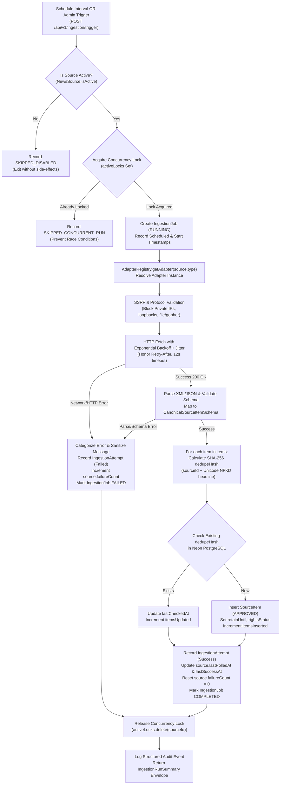

# Source Adapter Architecture & Ingestion Pipeline Specification
## Parmanu Platform — Phase 2.1: Live Data Ingestion, Connectors & Data Reliability

---

### 1. Executive Summary

Phase 2.1 establishes a production-grade data ingestion framework for the Parmanu platform. It provides a modular, extensible source-adapter architecture capable of collecting verified public domain announcements, licensed commercial news feeds, PR wire releases, and voluntary creator portfolio updates without ever scraping behind login walls or violating third-party terms of service.

The architecture decouples source ingestion into interchangeable, typed adapters orchestrated through a centralized registry with bounded concurrency, exponential backoff, jitter, dead-letter recording, and cryptographic deduplication.

---

### 2. End-to-End Ingestion Lifecycle



---

### 3. Detailed Architectural Components

#### 3.1 Source Adapter Contract (`SourceAdapter`)
Every connector in Parmanu implements the standardized `SourceAdapter` contract defined in `apps/api/src/connectors/base.connector.ts`:

```typescript
export interface SourceAdapter {
  readonly id: string;
  readonly name: string;
  readonly sourceType: SourceType;
  readonly supportedContentTypes: ContentType[];
  readonly attributionRequirement: string;
  fetch(sourceConfig: SourceAdapterConfig): Promise<ConnectorFetchResult>;
  healthCheck(sourceConfig: SourceAdapterConfig): Promise<ConnectorHealth>;
}
```

#### 3.2 Implemented Source Connectors

| Adapter Name | SourceType | Target Endpoint / Protocol | Licensing & Rights | Provenance State | Key Features |
|---|---|---|---|---|---|
| **Standard RSS / Atom Connector** | `RSS`, `ATOM` | Public RSS 2.0 / Atom XML | `METADATA_ONLY` | `SINGLE_SOURCE` | HTML tag scrubbing, entity unescaping, pubDate parsing, enclosure thumbnail extraction |
| **Government & Statutory Feed** | `GOVERNMENT_FEED` | PIB India, RBI, Sansad, SEBI (`.gov.in`, `.rbi.org.in`) | `PUBLIC_DOMAIN` | `OFFICIAL_CONFIRMED` | Official domain whitelisting, 365-day retention, high-trust gazette categorization |
| **The Guardian Open Platform API** | `API_GUARDIAN` | `https://content.guardianapis.com/search` | `LICENSED_EXCERPT` | `CORROBORATED` | Commercial REST API, AES-256-GCM encrypted API key, section filtering, byline preservation |
| **GNews Commercial API** | `API_GNEWS` | `https://gnews.io/api/v4/top-headlines` | `METADATA_ONLY` | `SINGLE_SOURCE` | Indian national headlines, 429 quota backoff, publisher attribution preservation |
| **PR Wire & Corporate Wire** | `MANUAL_PR` | PR Newswire India, Business Wire | `METADATA_ONLY` | `SINGLE_SOURCE` | NLP heuristic collaboration radar, regex brand ambassador & sponsorship detection |
| **Meta Instagram Graph API** | `INSTAGRAM_API` | `https://graph.instagram.com/me/media` | `METADATA_ONLY` | `OFFICIAL_CONFIRMED` | **Voluntary creator OAuth only**. Strictly no scraping. Token decryption, sponsorship `#ad` detection |

#### 3.3 Adapter Registry (`AdapterRegistry`)
Located in `apps/api/src/ingestion/adapter.registry.ts`, the registry maintains a singleton dictionary mapping `SourceType` to registered adapters. It enables adding future connectors (e.g. YouTube Data API, Substack RSS) without modifying the ingestion orchestrator.

#### 3.4 Bounded Concurrency & Scheduler
- **Scheduler (`IngestionScheduler`)**: Interval-based timer inspecting sources whose `pollingIntervalMinutes` has elapsed.
- **Worker Pool**: Bounded concurrency pool (`concurrencyLimit = 3`) preventing connection exhaustion against upstream providers and local database connection pools.
- **In-Memory Concurrency Lock**: `activeLocks = new Set<string>()` ensures that a slow poll of a given source cannot overlap with a subsequent scheduled trigger or manual admin run.

#### 3.5 Error Handling, Exponential Backoff & Retry
The `withRetry` utility in `base.connector.ts` guarantees resilience:
- **Max Attempts**: 3 attempts (default).
- **Backoff Algorithm**: Exponential factor of 2 with $\pm 20\%$ random jitter.
- **Retry-After Compliance**: Respects upstream HTTP `Retry-After` response header up to 60 seconds.
- **Failure Categorization**:
  - `NETWORK_TIMEOUT` (Aborted via `AbortController` after 12s)
  - `RATE_LIMITED` (HTTP 429 / provider quota exceeded)
  - `HTTP_ERROR` (5xx server errors)
  - `AUTH_ERROR` (HTTP 401/403, missing or expired OAuth token)
  - `PARSE_ERROR` (Malformed XML or invalid JSON)
  - `VALIDATION_ERROR` (Missing mandatory headline, link, or schema mismatch)
  - `SSRF_BLOCKED` (Private IP or forbidden loopback address)
  - `SOURCE_DISABLED` (Source marked `isActive: false`)

#### 3.6 Secret Redaction & Log Sanitization
Error details logged to the console, stored in `IngestionAttempt.errorMessage`, or returned to client envelopes are passed through `sanitizeErrorMessage()`:
- Redacts `api_key=...`, `access_token=...`, `Bearer ...`, passwords, and client secrets.
- Prevents secret exfiltration through logs or observability platforms.
