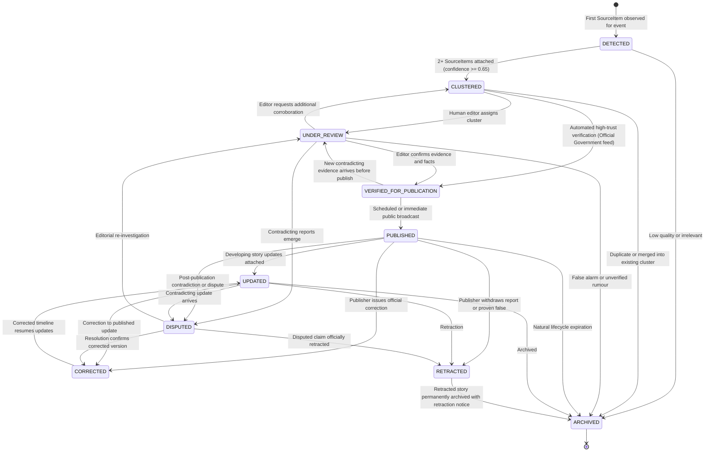
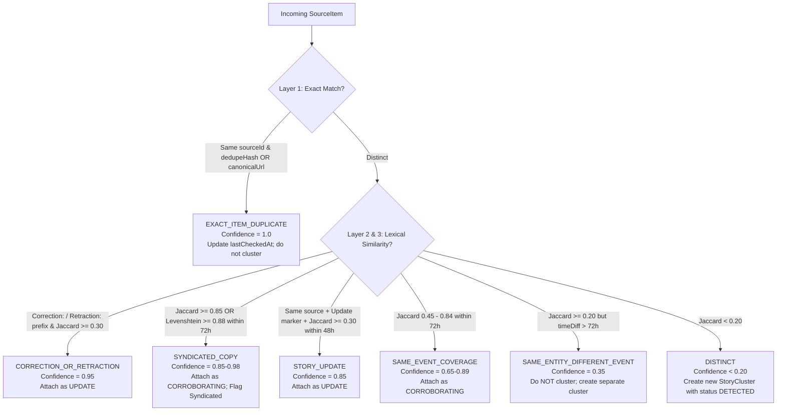
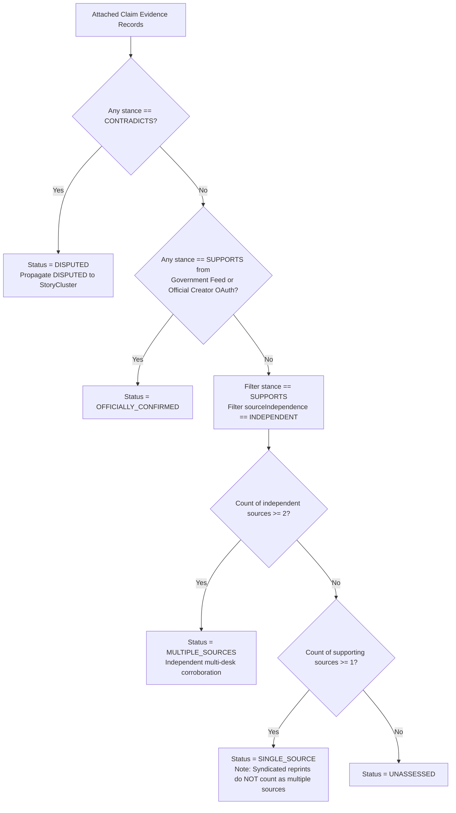
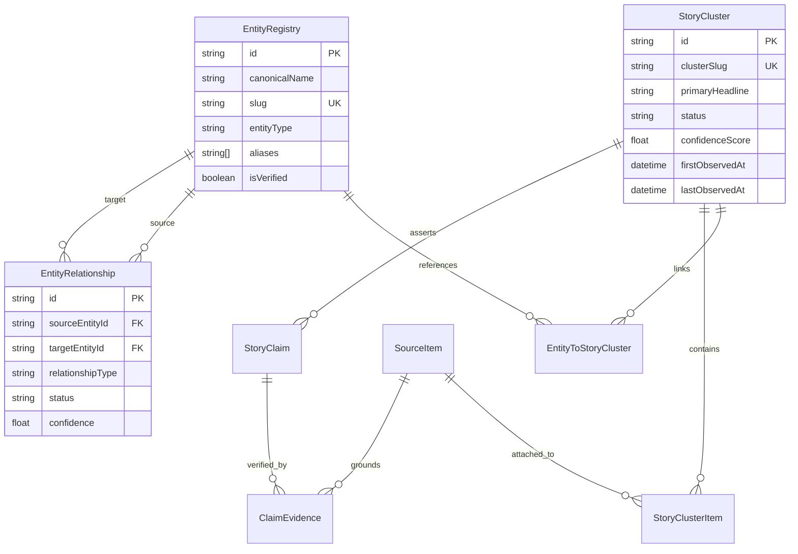

# Story Lifecycle, Evidence Flow & Entity Relationship Architecture
## Parmanu Platform — Phase 2.2: Story Intelligence & Verification Engine

---

### 1. Architectural Overview

Phase 2.2 delivers the story intelligence, deduplication, and evidence verification engine on top of Parmanu's Phase 2.1 data ingestion pipeline. It transforms multiple incoming content records (articles, official gazettes, press releases, voluntary creator posts) into coherent, clustered, traceable stories without losing the original sources or presenting speculation as fact.

---

### 2. Story Cluster Lifecycle Architecture

---

### 3. Layered Deduplication & Similarity Engine

Incoming records pass through a 5-layer deterministic evaluation against candidate items within a rolling 72-hour event window:

---

### 4. Evidence Verification & Non-Syndication Rules

Parmanu enforces strict evidentiary rules before upgrading a story's status:

#### Core Evidence Rules:
1. **The Syndication Rule**: Multiple news websites repeating the exact same wire report (e.g. PTI wire syndicated to 5 news portals) do **not** constitute independent corroboration. They are recorded with `sourceIndependence: SYNDICATED` and count as a single primary source.
2. **The Official Confirmation Rule**: Only primary statements issued directly through verified Government portals (`.gov.in`, `rbi.org.in`) or an authenticated creator's own voluntary OAuth account can confer `OFFICIALLY_CONFIRMED` status.
3. **The Contradiction Gate**: Any credible contradicting statement immediately transitions the claim and its parent cluster to `DISPUTED` for editorial adjudication.

---

### 5. Entity Resolution & Collaboration Graph

#### Collaboration Truthfulness Guarantees:
- **No Unsubstantiated Upgrades**: Rumored relationships (`RUMORED_RELATIONSHIP`) can never be initialized or upgraded to `CONFIRMED` without direct evidence from an official brand press release or creator disclosure.
- **Anti-Conflation Guarantee**: Two individuals or brands sharing a common name or alias are never automatically merged into a single entity without explicit admin review.
