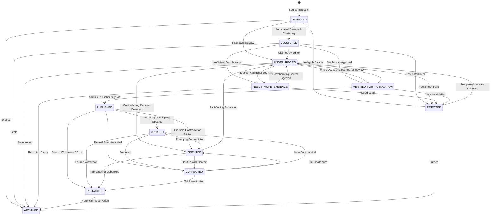

# PARMANU EDITORIAL CMS WORKFLOW RUNBOOK
## Phase 2.3 — Editorial Governance, Verification & Publication Protocols

---

### 1. Editorial Lifecycle State Machine

The Parmanu editorial pipeline enforces a strict server-side state machine on every `StoryCluster`. Status transitions cannot be bypassed by frontend shortcuts or client-side tampering.



---

### 2. Roles and Separation of Duties

| Role | Permitted Actions | Prohibited Actions | Guard Middleware |
| :--- | :--- | :--- | :--- |
| **READER** | Read published stories (`/news`, `/source-items`), read public story clusters, read verified creator radar signals. | Cannot view unapproved drafts, cannot inspect private reviewer notes, cannot publish, cannot modify sources. | `optionalAuth` / Public endpoints |
| **EDITOR** | Triage review queue, claim story clusters, inspect raw evidence records, verify claims, record approval (`VERIFIED_FOR_PUBLICATION`), flag `DISPUTED`, request `NEEDS_MORE_EVIDENCE`, record corrections. | Cannot publish to live consumer feed (`PUBLISHED`), cannot retract published stories, cannot register/modify news sources, cannot view audit logs. | `requireRole(['EDITOR', 'ADMIN'])` |
| **ADMIN** | Full publisher privileges: publish approved stories to live consumer feed, retract stories, configure news sources, trigger manual ingestion, merge/split clusters, manage user roles, inspect audit trail. | None (subject to immutable audit logging). | `requireRole(['ADMIN'])` |

---

### 3. Step-by-Step Story Verification Procedure

#### Step 1: Queue Triage
1. Open the **Editorial CMS** dashboard (`/` -> Tab: Editorial CMS).
2. Filter the queue by **Priority: HIGH**. Items with multi-source coverage ($\ge 3$ sources) or disputed claims automatically receive high priority.
3. Click **Inspect & Review** on the candidate cluster.

#### Step 2: Source Provenance Inspection
1. Verify the primary publisher attribution and domain.
2. Check the canonical URL: ensure it originates from an approved syndicate, government feed (`.gov.in`), or licensed API.
3. Check the publication timestamp: ensure the article is within the relevant editorial window ($\le 48$ hours).

#### Step 3: Claim & Evidence Corroboration
1. Review each atomic claim in the **Claims & Evidence** section.
2. **The Corroboration Rule:** Multiple websites reproducing the identical syndicated press release (e.g., PTI or ANI wire copy) **do not count as independent confirmation**. Look for at least one independent investigative report or an official government statement.
3. Check evidence stances:
   - `SUPPORTS`: Directly verifies the factual claim.
   - `CONTRADICTS`: Rebuts or denies the claim (triggers `DISPUTED` badge).
   - `CONTEXTUALIZES`: Provides relevant background without confirming.

#### Step 4: AI Draft vs Human Decision Gate
- If an AI draft summary was generated, inspect it for hallucination.
- Parmanu's anti-hallucination gate automatically drops citations to entities not in the source text. However, human editorial approval is mandatory. An AI summary **must never be auto-published**.

#### Step 5: Recording the Decision
- If verified: Click **✓ Approve (Verify)**. Cluster moves to `VERIFIED_FOR_PUBLICATION`.
- If missing data: Click **Needs More Evidence**. Cluster moves to `NEEDS_MORE_EVIDENCE`.
- If false or irrelevant: Click **Reject**. Cluster moves to `REJECTED`.

---

### 4. Publication Protocol

Only an **ADMIN** (or designated Chief Editor with publishing rights) can release an approved cluster to the public consumer feed.

```http
POST /api/v1/clusters/:id/publish
Authorization: Bearer <ADMIN_JWT>
Content-Type: application/json

{
  "headline": "Optional revised headline",
  "summary": "Optional final edited summary",
  "editorialNotes": "Final sign-off by Chief Editor",
  "expectedVersion": 1
}
```

**Pre-conditions enforced by server:**
1. State must currently be `VERIFIED_FOR_PUBLICATION`.
2. Associated `itemCount` must be $\ge 1$.
3. Optimistic concurrency check: `expectedVersion` must match current database version.

---

### 5. Corrections and Retractions Protocol

Parmanu adheres to the **Never Silently Delete** newsroom integrity rule. A published story that contains errors is never quietly removed from the database; its correction or retraction is transparently recorded.

#### Recording a Public Correction:
```http
POST /api/v1/clusters/:id/correct
Authorization: Bearer <EDITOR_OR_ADMIN_JWT>
Content-Type: application/json

{
  "correctionNotice": "CORRECTION: An earlier version of this report stated that the launch occurred at 10:00 AM IST. Updated telemetry confirms liftoff took place at 10:15 AM IST.",
  "revisedHeadline": "Optional amended headline",
  "revisedSummary": "Optional amended summary",
  "expectedVersion": 2
}
```
- Cluster status moves to `CORRECTED`.
- Public response retains original story with a prominent `✎ Corrected` badge and the official notice.

#### Retracting a Published Story:
```http
POST /api/v1/clusters/:id/retract
Authorization: Bearer <ADMIN_JWT>
Content-Type: application/json

{
  "reason": "RETRACTION: The originating news agency withdrew this dispatch after the Ministry issued an official denial.",
  "expectedVersion": 2
}
```
- Cluster status moves to `RETRACTED`.
- Story is removed from active news feed recommendations, but permalinks display the retraction notice and historical timestamp.

---

### 6. Cluster Merge and Split Protocols

- **Merge:** When two separate clusters represent the same news event, merge the secondary into the primary using `POST /api/v1/clusters/merge`. All associated items and claims are transferred; the secondary is archived; a `ClusterMergeSplitLog` is created.
- **Split:** When unrelated news items were erroneously clustered together, detach them into a new cluster using `POST /api/v1/clusters/:id/split`.
